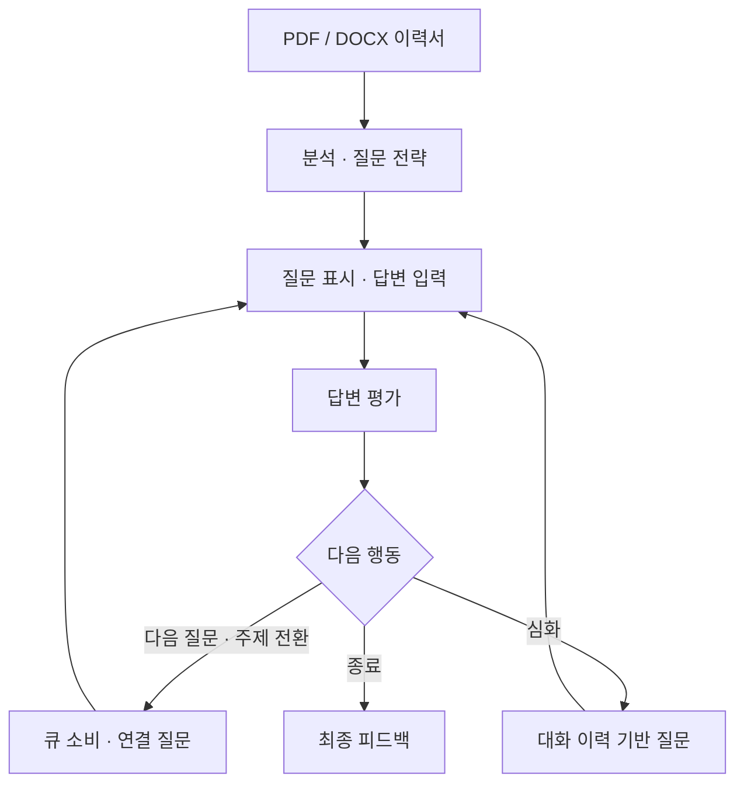

<div align="center">

# AI 면접관 Agent
### 답변을 읽고, 다음 질문을 결정하는 면접 연습 시스템

**KT AIVLE School 미니프로젝트 2차 | 김건우**


**이력서 분석 → 질문 전략 → 답변 평가 → 심화·주제 전환 → 피드백**

[핵심 구현](agent_nodes.py) · [실행 방법](#실행-방법) · [흐름 테스트](tests/test_flow.py) · [개발 기록](docs/DEVELOPMENT.md)

</div>

## 프로젝트 소개

정해진 질문을 차례로 나열하는 대신, **지원자의 답변과 남은 면접 주제를 고려해 다음 행동을 결정**하는 AI 면접관입니다. PDF/DOCX 이력서를 읽고 개인화된 질문 전략을 세운 뒤, 답변의 연관성과 구체성을 평가해 후속 질문과 피드백을 제공합니다.

## 제가 맡은 일과 성과

저는 **면접 진행 검토 고도화와 주제 전환 흐름 개선**을 담당했습니다.

| 기여 | 수행 내용 | 결과 |
|---|---|---|
| 진행 제어 구현안 | 팀원과 각자 구현안을 만든 뒤 팀에서 제 안을 채택 | 팀 면접 진행 기능에 채택된 구현 경험 |
| 다음 행동 결정 | 최근 평가·남은 질문·잔여 주제를 바탕으로 심화/다음 질문/주제 전환/종료 구분 | 답변과 상태를 반영하는 진행 구조 |
| 질문·주제 상태 관리 | `question_queue`, `remaining_topics`를 사용해 질문과 주제 소비 | 진행 상황을 명시적으로 관리 |
| 대화 품질 개선 | 주제가 바뀔 때 대화가 끊기는 문제를 확인하고 프롬프트를 여러 차례 수정 | 수정 후 연결이 자연스러워진 것을 확인 |

구현안 채택과 프롬프트 개선 결과는 당시 수행에 대한 본인 회고이며, 대화 품질 개선은 정성적 관찰입니다. 팀 전체의 이력서 분석·평가·질문 생성 기능과 개인 담당 범위를 구분했습니다.

## 핵심 기술: 상태에 따라 달라지는 다음 행동

| 입력 상태 | 판단·처리 |
|---|---|
| 최근 답변 평가 | 추가 설명이 필요한지 판단 |
| `question_queue` | 현재 주제의 준비된 질문 관리 |
| `remaining_topics` | 아직 다루지 않은 주제 관리 |
| `generate_count` | 질문별 심화 질문 횟수 관리 |
| `conversation` / `evaluation` | 질문·답변과 평가를 쌍으로 보관 |

LLM이 다음 행동을 선택하고, 코드가 **최대 5답변·질문별 최대 2회 심화**와 유효한 분기를 확인합니다. 질문을 만들면 호출자에게 돌려주고 새 답변을 기다립니다.



## 주제 전환을 대화로 연결하기

새 주제에서는 이전 질문과 답변, 다음 목표 질문을 함께 전달합니다. **이전 답변의 실제 내용을 짧게 짚고 다음 질문으로 연결**하도록 지시하며, 답변에 없는 경험이나 성과를 만들지 않도록 명시했습니다.

심화 질문에는 지금까지의 질문·답변·평가를 전달하고, 이전 질문의 반복을 피하면서 답변의 구체성과 기술적 이해를 확인하도록 구성했습니다.

이 절의 명시적 연결 프롬프트와 실행 경계·테스트는 **2026-10-29 저장소 보완 사항**입니다. 당시 반복 수정했던 프롬프트와 이번 공개본의 변경은 [개발 기록](docs/DEVELOPMENT.md)에서 구분합니다.

## 실행 방법

Python 3.11 이상에서 다음과 같이 실행합니다.

```bash
git clone https://github.com/withoutsultang/Interview_agent_aivle.git
cd Interview_agent_aivle
python -m venv .venv
# macOS / Linux
source .venv/bin/activate
# Windows PowerShell: .venv\Scripts\Activate.ps1
pip install -r requirements.txt
```

환경 변수로 `OPENAI_API_KEY`를 설정한 후 실행합니다. 이력서는 본인의 PDF 또는 DOCX 파일을 사용하세요.

```bash
# macOS / Linux
export OPENAI_API_KEY="your-api-key"
# Windows PowerShell: $env:OPENAI_API_KEY="your-api-key"
python main.py ./resumes/my_resume.pdf
```

또는 `.env.example`을 `.env`로 복사해 값을 입력하고 명시적으로 불러올 수 있습니다.

```bash
python main.py ./resumes/my_resume.docx --key-file .env
```

빈 답변은 다시 입력받으며 `/quit`로 종료할 수 있습니다. 실제 실행은 OpenAI API를 사용하고 이력서·답변을 모델에 전달합니다. `.env`와 개인 이력서 폴더는 Git에서 제외했습니다.

## 테스트

```bash
python -m unittest discover -s tests -v
```

실제 LangGraph와 대체 LLM 응답으로 **답변 1개당 평가 1회**, 5턴 종료, 주제 전환 입력, 심화 제한, 잘못된 분기 응답, 빈 답변, PDF/DOCX 추출을 검증합니다. 테스트에는 API 키와 유료 호출이 필요하지 않습니다.

## 기술 구성

| 기술 | 역할 |
|---|---|
| LangGraph | 상태 기반 면접 흐름·조건 분기 |
| LangChain Core | 프롬프트 구성·JSON/문자열 파싱 |
| GPT-4o-mini | 이력서 요약·질문 전략·평가·후속 질문 |
| PyMuPDF / python-docx | 이력서 텍스트 추출 |
| unittest / FakeListChatModel | 외부 API 없이 흐름 검증 |

## 파일 구성

```text
agent_nodes.py      State · 프롬프트 · 질문/평가 노드 · 그래프
main.py             CLI · 인증 설정 · 사용자 답변 루프
utils.py            문서 추출 · 피드백 출력
tests/test_flow.py  그래프와 입력 경계 테스트
docs/DEVELOPMENT.md 당시 기여와 공개본 보완 기록
requirements.txt    검증에 사용한 직접 의존성 버전
```

## 보여드릴 수 있는 역량

- **프로세스 설계:** 답변 평가와 잔여 질문을 연결하는 상태 기반 진행 제어
- **사용자 관점 개선:** 대화가 끊기는 지점을 발견하고 프롬프트를 반복 조정
- **팀 내 구현 협업:** 각자 만든 구현안을 팀 기능으로 통합한 경험
- **실행 흐름 검증:** 입력·평가 경계를 분리하고 대체 모델로 분기와 종료 조건 확인

교육 과정의 과제·골격을 바탕으로 수행한 팀 프로젝트이며, 이 저장소는 개인 담당 경험과 공개 실행본을 함께 정리한 포트폴리오입니다.
